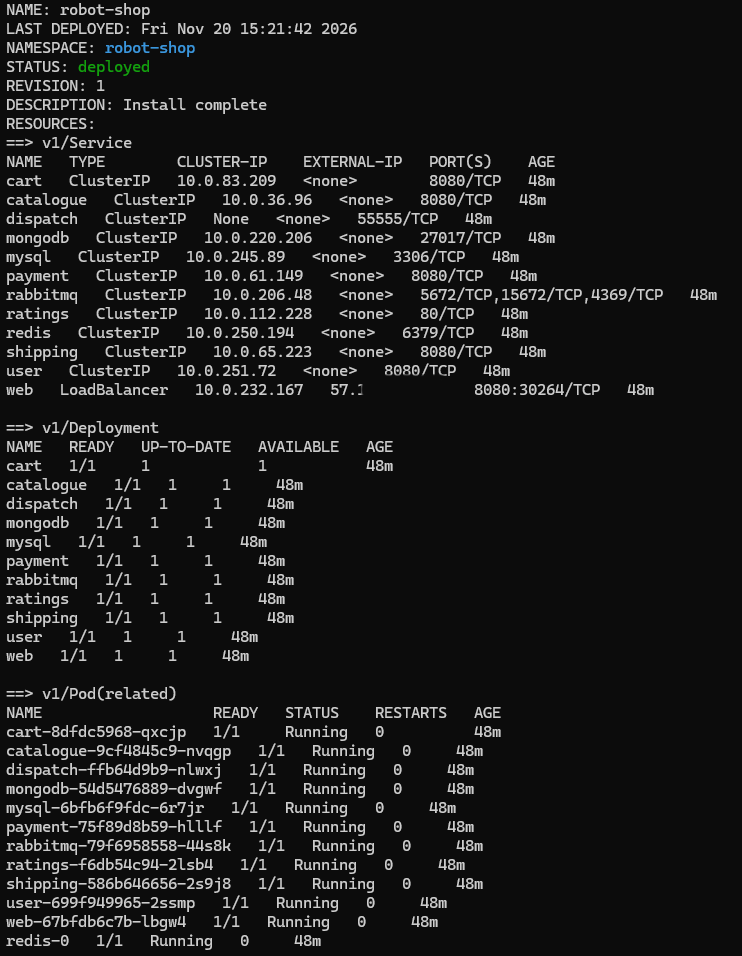

# Robot Shop Helm Chart on AKS

This chart deploys the upstream Robot Shop microservices sample to Azure Kubernetes Service (AKS). It creates the application's Kubernetes workloads and Services. Robot Shop is for demonstration and learning, not production commerce.

The chart does not provision Azure resources, build or publish container images, configure Azure identities or service connections, or grant ACR pull access. Those responsibilities are handled separately by the v1.3.0 infrastructure and Docker CI stages, or by an operator following the manual prerequisites.

## Contents

- [v1.3.0 deployment path](#v130-deployment-path)
- [Helm evolution by release](#helm-evolution-by-release)
- [Prerequisites](#prerequisites)
- [Container images](#container-images)
- [Manual Helm deployment fallback](#manual-helm-deployment-fallback)
- [Verify the release and access the app](#verify-the-release-and-access-the-app)
- [Common chart values](#common-chart-values)
- [AKS chart notes](#aks-chart-notes)
- [Uninstall](#uninstall)

## v1.3.0 deployment path

Use the released workflow from the repository's `main` branch. The root [README](../../README.md) documents checkout, Azure DevOps setup, WIF, Kubernetes RBAC, the full deployment, and infrastructure cleanup.

The primary path is the [`ecommerce-master-deployment`](../../azure-pipelines-master.yml) pipeline. It runs Infrastructure, Docker CI, and Helm CD in sequence. Docker CI builds and pushes the ten application images to ACR using `Build.BuildId` as their shared tag. Helm CD deploys that tag and checks the Helm release status and workload rollout status.

For an isolated Helm deployment, the standalone [`pipelines/helm-aks-cd.yml`](../../pipelines/helm-aks-cd.yml) pipeline accepts an explicit `imageTag`. That tag must already exist in ACR; this pipeline does not build or push images. Configure the WIF service connections, namespace Role and RoleBinding, and AKS kubelet identity's `AcrPull` permission as described in the root README.

## Helm evolution by release

The chart is the deployment foundation throughout the project. The notable Helm progression has been in how images and releases are delivered:

| Version | Helm-related milestone |
|---|---|
| [v1.0.0](https://github.com/sharadshukla/E-Commerce/releases/tag/v1.0.0) | Deployed Robot Shop to AKS with the Helm chart. Installation and image delivery were manual. |
| [v1.1.0](https://github.com/sharadshukla/E-Commerce/releases/tag/v1.1.0) | Automated image publishing to ACR; Helm installation and AKS deployment remained manual. |
| [v1.2.0](https://github.com/sharadshukla/E-Commerce/releases/tag/v1.2.0) | Added a dedicated Helm CD pipeline with WIF, namespace-scoped Kubernetes RBAC, and an explicit image tag. |
| **v1.3.0 — current implementation** | Integrated Helm CD into the master pipeline so it deploys the tag produced by Docker CI and verifies release and workload rollout status. GitHub release publication is pending approval. |

The published release history and the broader Azure platform evolution are summarized in the [root README](../../README.md#project-evolution).

## Prerequisites

- An AKS cluster with `kubectl` access and Helm 3.
- The ten application images listed below, published to ACR with a common tag.
- The AKS **kubelet managed identity** granted the `AcrPull` role on the registry.
- A Kubernetes StorageClass named `default` for the Redis PVC. The chart currently names this StorageClass directly in its Redis StatefulSet template.
- Outbound access from AKS nodes to Docker Hub for `redis:4.0.6`, `rabbitmq:3.7-management-alpine` and any other upstream images used by the chart.

Check cluster connectivity and StorageClasses:

```powershell
kubectl get nodes
kubectl get storageclass
```

## Container images

The chart forms application image references from `image.repo` and `image.version`. These ten repositories must exist in the selected registry with the image tag you deploy:

```text
rs-cart
rs-catalogue
rs-dispatch
rs-mongodb
rs-mysql-db
rs-payment
rs-ratings
rs-shipping
rs-user
rs-web
```

Redis is pulled separately from Docker Hub as `redis:4.0.6`.

## Manual Helm deployment fallback

Use this procedure when deploying outside the Azure DevOps Helm CD pipeline. Run it from the repository root in PowerShell. Replace the registry hostname and image tag with values that exist in ACR. The chart's default image tag is `v1`; explicitly set the tag published by Docker CI.

```powershell
$acrLoginServer = '<your-registry>.azurecr.io'
$imageTag = '<Build.BuildId from your Docker CI run>'

helm lint .\AKS\helm

helm upgrade --install robot-shop .\AKS\helm `
  --namespace robot-shop `
  --create-namespace `
  --wait `
  --timeout 15m `
  --set "image.repo=$acrLoginServer" `
  --set-string "image.version=$imageTag"
```

The signed-in identity must already have the required Kubernetes permissions. This command deploys the chart but does not create the namespace-scoped Helm Role or RoleBinding, provision AKS or ACR, publish images, or grant `AcrPull` to the kubelet identity.

## Verify the release and access the app

```powershell
helm status robot-shop --namespace robot-shop
kubectl get pods --namespace robot-shop
kubectl get deployments,statefulsets --namespace robot-shop
kubectl get services --namespace robot-shop
kubectl get pvc --namespace robot-shop
```

The `web` Service is a public LoadBalancer on port `8080`. Wait for an external address, then open `http://<EXTERNAL-IP>:8080`. This chart does not configure Ingress, TLS, or a custom domain.



*v1.3.0 deployment evidence captured on 20 November 2026. The public LoadBalancer IP is partially redacted.*

## Common chart values

| Value | Default | Purpose |
|---|---|---|
| `image.repo` | `ecommerceregistrynew.azurecr.io` | Registry hostname used for the ten Robot Shop images. Override it with your ACR login server. |
| `image.version` | `v1` | Image tag. The master pipeline overrides it with `Build.BuildId`; manual deployments should set a tag already in ACR. |
| `image.pullPolicy` | `IfNotPresent` | Kubernetes image pull policy. |
| `nodeport` | `false` | Uses a LoadBalancer for the web Service; `true` selects NodePort. |
| `payment.gateway` | `null` | Optional URL for an alternative sample payment gateway. |
| `eum.key`, `eum.url` | No key; upstream endpoint | Optional Instana website monitoring settings. Do not put real credentials in values files or command history. |
| `<workload>.affinity` | `{}` | Optional scheduling affinity for an individual workload. |
| `<workload>.nodeSelector` | `{}` | Optional node labels for an individual workload. |
| `<workload>.tolerations` | `[]` | Optional tolerations for an individual workload. |

Scheduling options can be set for `cart`, `catalogue`, `dispatch`, `mongodb`, `mysql`, `payment`, `rabbitmq`, `ratings`, `redis`, `shipping`, `user`, and `web`. For example, save this as a values override file and pass it with `-f` to `helm upgrade --install`:

```yaml
web:
  nodeSelector:
    kubernetes.io/os: linux
  tolerations: []
```

## AKS chart notes

- Redis requests a 1 Gi persistent volume. The StatefulSet template hard-codes `storageClassName: default`; `redis.storageClassName` in `values.yaml` is not wired into the template. Confirm the `default` StorageClass exists before installing.
- MySQL has no persistent volume, so its data is not durable across pod replacement.
- Keep `psp.enabled` set to `false`; Pod Security Policy is a legacy chart option.
- NodePort and Instana monitoring are optional upstream settings and are not required by the documented Azure deployment.

## Uninstall

```powershell
helm uninstall robot-shop --namespace robot-shop
```

Check for remaining PVCs separately if you also intend to delete the Redis volume and its data. For full Azure resource cleanup, use the guarded procedure in the [root README](../../README.md).
