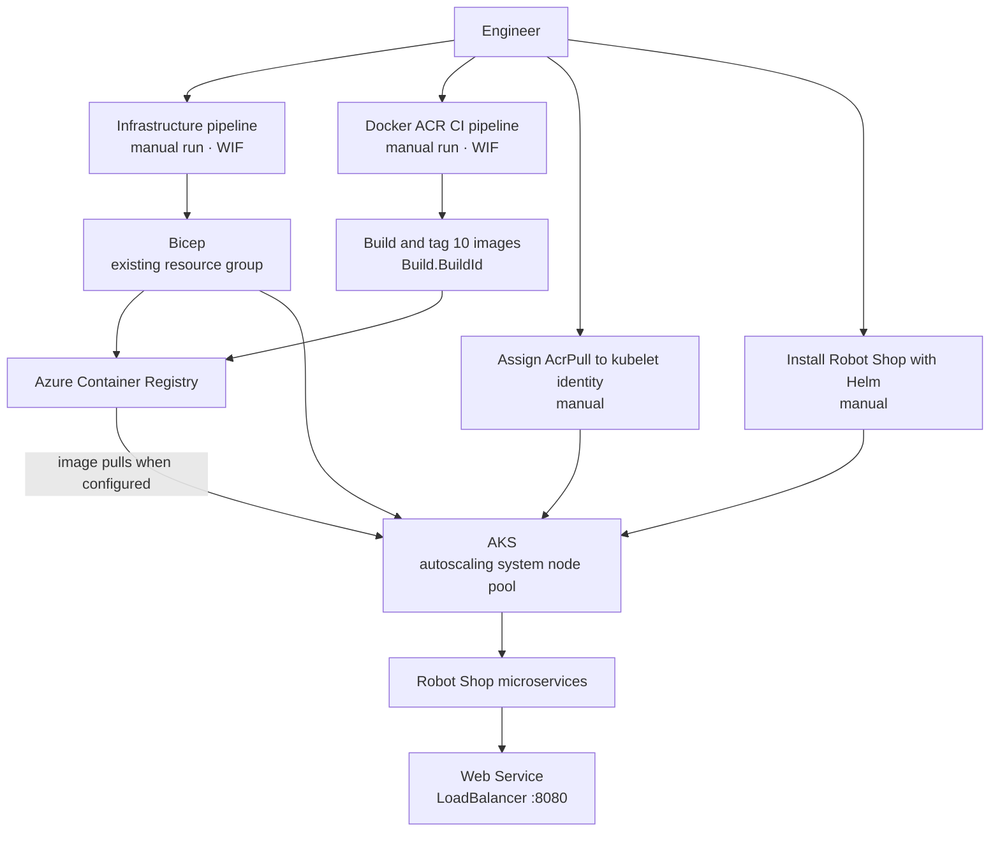

# Azure E-Commerce Platform on AKS

**Infrastructure as Code and deployment of the Robot Shop microservices sample on Microsoft Azure.**

This project takes the upstream [Robot Shop](https://github.com/instana/robot-shop) demonstration application and adds an Azure platform deployment: infrastructure provisioned with Bicep, automated container image publishing to Azure Container Registry (ACR) through Azure DevOps, Azure Kubernetes Service (AKS), and a Helm chart.

The application is an upstream sample, not a production commerce platform. This repository’s engineering focus is the Azure infrastructure and deployment workflow around it.

## Table of contents

- [What this project implements](#what-this-project-implements)
- [Architecture](#architecture)
- [Architecture decisions](#architecture-decisions)
- [Deployment workflow](#deployment-workflow)
  - [Prerequisites](#prerequisites)
  - [Provision ACR and AKS](#1-provision-acr-and-aks)
  - [Grant AKS permission to pull from ACR](#2-grant-aks-permission-to-pull-from-acr)
  - [Build and push the application images](#3-build-and-push-the-application-images)
  - [Deploy the application with Helm](#4-deploy-the-application-with-helm)
  - [Verify the deployment](#5-verify-the-deployment)
- [Deployment evidence](#deployment-evidence)
- [Operational learning](#operational-learning)
- [Scope and limitations](#scope-and-limitations)
- [Next iterations](#next-iterations)
- [Repository areas](#repository-areas)
- [Upstream project and license](#upstream-project-and-license)

## What this project implements

- Azure infrastructure defined in Bicep: ACR and AKS, with the AKS resource in a reusable module and parameters for selective ACR/AKS deployment.
- An Azure DevOps infrastructure pipeline that validates the Bicep template, authenticates through a workload identity federation service connection, and deploys infrastructure into an existing resource group.
- A separate Azure DevOps Docker pipeline that builds, tags with `Build.BuildId`, and pushes all ten application images to ACR using workload identity federation and registry-scoped `AcrPush`.
- An AKS system node pool configured for cluster autoscaling from one to three nodes.
- An AKS Helm chart configured to use version-tagged images in ACR.
- A Kubernetes LoadBalancer Service for the web frontend.

**Automation boundary (v1.1.0):** The infrastructure and Docker image publishing pipelines are separate, manually triggered workflows. The AKS kubelet identity’s `AcrPull` assignment and the Helm application deployment remain manual.

## Architecture



The Bicep deployment expects the resource group to exist already. The two pipelines were verified independently; the newly published Build ID images have not been verified in an AKS deployment. The application’s web Service used port **8080** in the recorded AKS deployment; the remaining application Services were internal cluster Services. No Application Gateway or Ingress-based public entry point was part of the verified deployment.

## Architecture decisions

| Decision | Reason and trade-off |
|---|---|
| Bicep for Azure resources | Keeps ACR and AKS configuration declarative and repeatable, including optional ACR-only provisioning. The infrastructure pipeline deploys to an existing resource group rather than creating the resource group. |
| Azure DevOps workload identity federation | Lets both pipelines authenticate to Azure through a service connection without storing a client secret in YAML. Azure RBAC separately governs deployment and registry access. |
| Registry-scoped image publishing | The Docker pipeline uses `AcrPush` on the registry rather than the ACR admin account; Build ID tags distinguish pipeline runs. |
| ACR admin account disabled | Avoids using the registry’s shared admin credentials. AKS image-pull access was granted separately to its kubelet managed identity. That role assignment was manual in this release. |
| Helm for application resources | Groups the microservice Kubernetes resources and image settings in one chart. The chart install was a separate manual operation from infrastructure provisioning. |
| LoadBalancer Service on port 8080 | Provided a direct browser-accessible endpoint for this learning deployment. It creates a public Azure endpoint and is not a production ingress/TLS design. |
| One autoscaling system node pool | Kept the learning cluster simple while allowing the node count to vary between one and three. This is cluster autoscaling; the project does not configure application HPA. |

## Deployment workflow

### Prerequisites

- An Azure subscription and an **existing** resource group.
- Azure DevOps access and a configured workload identity federation service connection with permission to deploy into that resource group and `AcrPush` on the registry for image publishing.
- A self-hosted Azure Pipelines agent with Azure CLI, Docker CLI, and a reachable Docker Engine configured for Linux containers. The verified CI run used a self-hosted Windows agent.
- Azure CLI, kubectl, and Helm for manual AKS configuration, deployment, and verification.

### 1. Provision ACR and AKS

Run the infrastructure Azure DevOps pipeline manually. It checks Bicep availability, builds the Bicep template, verifies Azure and resource-group access, then deploys `infra/main.bicep`.

The template has `deployAcr` and `deployAks` Boolean parameters, both defaulting to `true`. An ACR-only deployment was verified with `deployAcr=true` and `deployAks=false`. The template does not create the resource group, assign `AcrPull` to the AKS kubelet identity, build container images, or install the Helm chart. Confirm how parameters are passed by the infrastructure pipeline before assuming it supports selective deployments through its UI.

### 2. Grant AKS permission to pull from ACR

After AKS and ACR exist, assign the `AcrPull` role to the AKS **kubelet identity** at the registry scope. This step was manual for this release. Use the kubelet identity object ID, not the AKS control-plane identity.

### 3. Build and push the application images

Run the separate Azure DevOps pipeline defined in [`pipelines/docker-acr.yml`](pipelines/docker-acr.yml). It uses the `sc-az-ecommerce-wif` service connection to authenticate to ACR, then builds, tags, and pushes the ten Robot Shop images from their respective Dockerfiles. Image tags use the Azure DevOps `Build.BuildId` value; no registry admin password is required.

The pipeline successfully published all ten repositories to `ecommerceregistrynew.azurecr.io` with tag **`60`** on 14 October 2026. The images are `rs-cart`, `rs-catalogue`, `rs-dispatch`, `rs-mongodb`, `rs-mysql-db`, `rs-payment`, `rs-ratings`, `rs-shipping`, `rs-user`, and `rs-web`. The chart uses a separate Redis image.

This pipeline publishes images to ACR; it does **not** deploy them to AKS or change the Helm release. Record the resulting Build ID for any later Helm deployment.

### 4. Deploy the application with Helm

After provisioning AKS and granting its kubelet identity `AcrPull`, install the chart manually with the registry and a tag that exists for all required application images. The example below uses `60`, which was published by the CI pipeline but has **not** been verified as an AKS deployment:

```bash
helm upgrade --install robot-shop ./AKS/helm \
  --namespace robot-shop \
  --create-namespace \
  --wait \
  --timeout 10m \
  --set "image.repo=$ACR_LOGIN_SERVER" \
  --set image.version=60
```

### 5. Verify the deployment

```bash
kubectl get pods -n robot-shop
kubectl get services -n robot-shop
helm status robot-shop -n robot-shop
```

Confirm that the pods are ready, the `web` Service has an external address, and the storefront responds on the Service’s exposed port.

## Deployment evidence

The **AKS application deployment** was verified on **11 October 2026** using the earlier `v1` image tag. That cluster was subsequently removed, so the outputs below are historical evidence and this repository does not provide a live demo endpoint. ACR was later recreated for CI testing; publishing tag `60` does not constitute a new AKS deployment.


*AKS pod status captured during the 11 October 2026 deployment verification.*

All 12 application pods were ready and running at capture time:

```text
NAME       READY   STATUS
cart       1/1     Running
catalogue  1/1     Running
dispatch   1/1     Running
mongodb    1/1     Running
mysql      1/1     Running
payment    1/1     Running
rabbitmq   1/1     Running
ratings    1/1     Running
redis      1/1     Running
shipping   1/1     Running
user       1/1     Running
web        1/1     Running
```

The Services showed the expected internal microservice endpoints and a public LoadBalancer for the web frontend. Addresses are omitted because they belonged to the temporary cluster:

| Service | Type | Port(s) |
|---|---|---|
| cart, catalogue, payment, shipping, user | ClusterIP | 8080/TCP |
| dispatch | ClusterIP (headless) | 55555/TCP |
| mongodb | ClusterIP | 27017/TCP |
| mysql | ClusterIP | 3306/TCP |
| rabbitmq | ClusterIP | 5672/TCP, 15672/TCP, 4369/TCP |
| ratings | ClusterIP | 80/TCP |
| redis | ClusterIP | 6379/TCP |
| web | LoadBalancer | 8080/TCP |

Both AKS nodes were `Ready`, and the storefront was reachable through the web Service during verification.

## Operational learning

During startup, MySQL’s initialization took unusually long and dependent services, including Ratings and Shipping, were not initially ready. MySQL logs showed extended initialization delays. A controlled MySQL restart restored TCP connectivity, after which those dependent services recovered and the storefront became reachable. No MySQL image or source patch was made, and the precise cause of the delay was not established.

The initial Helm install used `--wait` and timed out while the application was still initializing. Although the workloads later recovered, the captured Helm release status remained `failed`; a subsequent Helm upgrade/reconciliation was not run before cleanup. This is why the historical evidence distinguishes application recovery from Helm’s recorded operation status.

## Scope and limitations

- Robot Shop is an upstream demonstration application and is **not intended for production use**; its own upstream documentation notes limited error handling and missing application security.
- The resource group must be created before the pipeline runs.
- Container builds and ACR pushes are automated by a manually triggered pipeline. The kubelet `AcrPull` assignment and Helm deployment remain manual.
- The MySQL workload has no persistent volume in this chart, so database data is not durable across pod replacement.
- The web Service uses a public LoadBalancer on port 8080; ingress, custom domain, and TLS are not configured.
- The recorded AKS deployment used tag `v1`; the later CI run published tag `60` to ACR without deploying it to AKS. Digest-pinned deployment and an end-to-end image release process remain future improvements.
- The recorded Helm install timed out and its release status was not reconciled after application recovery.

## Next iterations

The next versions can build on this working infrastructure and application deployment path in small, verifiable steps:

1. **Automate application deployment:** consume CI-published image tags and deploy the Helm release from Azure Pipelines; consider digest pinning for stronger release traceability.
2. **Automate Azure permissions:** provision the AKS kubelet identity’s `AcrPull` role assignment as part of the infrastructure workflow, with least-privilege scope.
3. **Improve application operations:** add persistent storage and backup for stateful services, then configure health checks and application autoscaling where the upstream app supports them.
4. **Add secure public access:** introduce an ingress or gateway, TLS, and a custom domain; move application secrets into an appropriate secret-management flow.
5. **Add observability and controlled load testing:** integrate Azure Monitor/Log Analytics and run a documented non-production load test. The repository’s Fluentd and Locust examples, if retained, should be treated as optional examples until they are wired into and tested with this Azure deployment.

These are candidate improvements, not features delivered by v1.1.0. The application itself remains an upstream demonstration project and is not being presented as production-ready.

## Repository areas

- `infra/` — Bicep entry point and AKS module.
- `AKS/helm/` — Helm chart and Kubernetes templates.
- `azure-pipelines.yml` — Azure DevOps infrastructure pipeline.
- `pipelines/docker-acr.yml` — Azure DevOps Docker build, tag, and ACR push pipeline.
- Application service directories — upstream Robot Shop source and Dockerfiles.
- `docker-compose.yaml` — upstream local development path.
- `docs/images/` — selected, sanitized deployment evidence screenshots.
- Optional upstream examples such as `fluentd/` and `load-gen/` are outside the verified Azure v1 deployment scope.

## Upstream project and license

The application is based on [Instana Robot Shop](https://github.com/instana/robot-shop). The application source and its microservice design are upstream work; this project adds the Azure infrastructure and deployment workflow described above. The repository includes the upstream Apache 2.0 license; see [LICENSE](LICENSE).

---

**Release scope:** v1.1.0 adds verified Docker image build-and-push automation and selective Bicep resource deployment to the v1.0.0 infrastructure and historical AKS application deployment. Helm deployment and AKS image-pull authorization remain manual.

