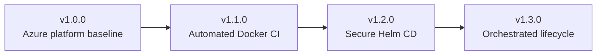
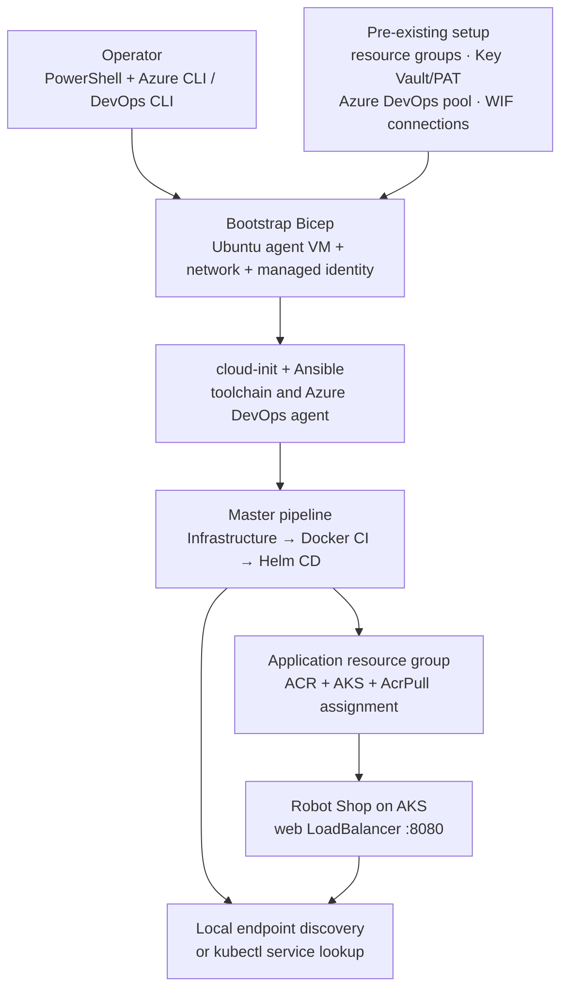
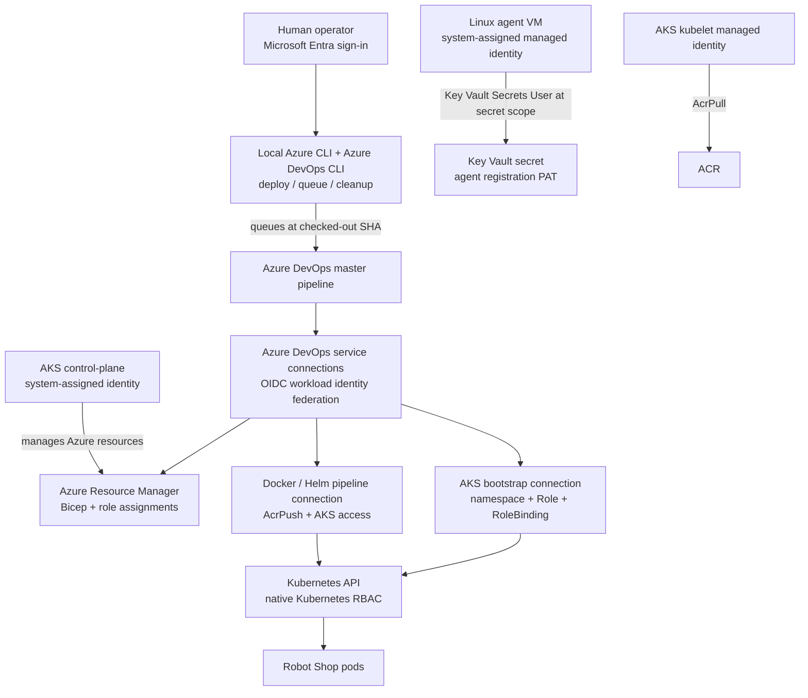
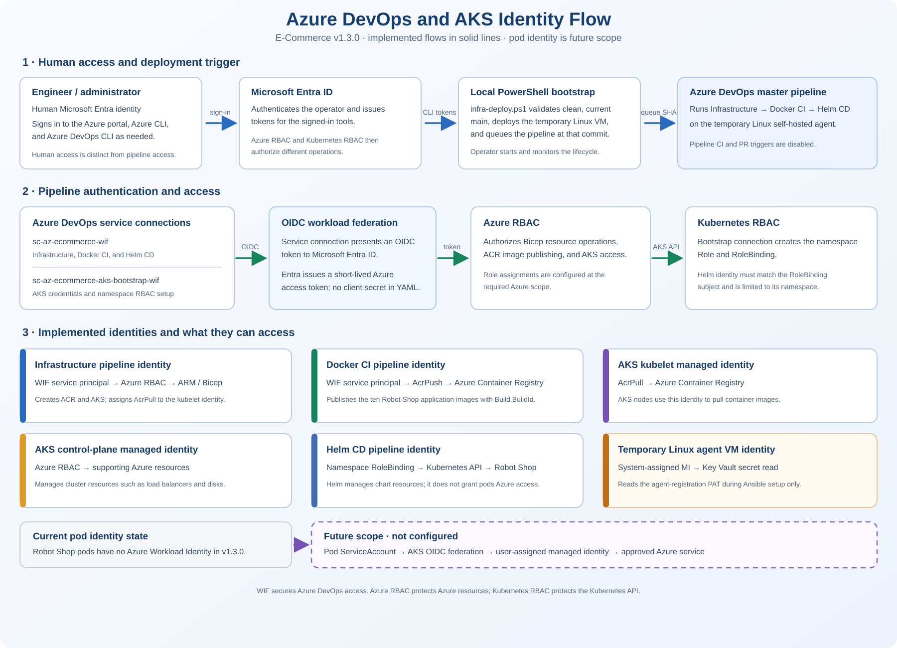
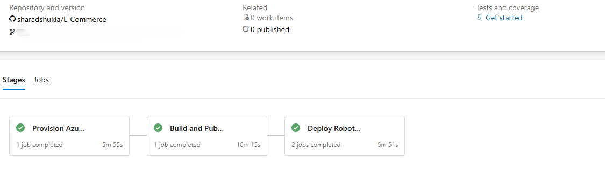
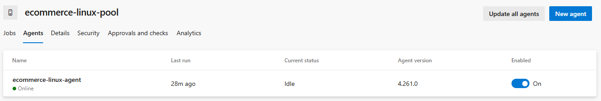
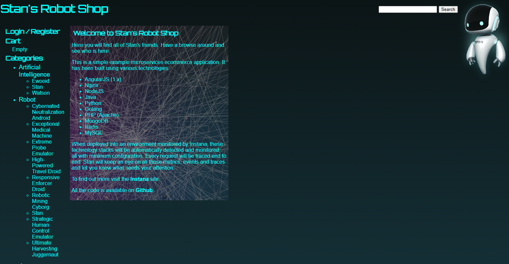
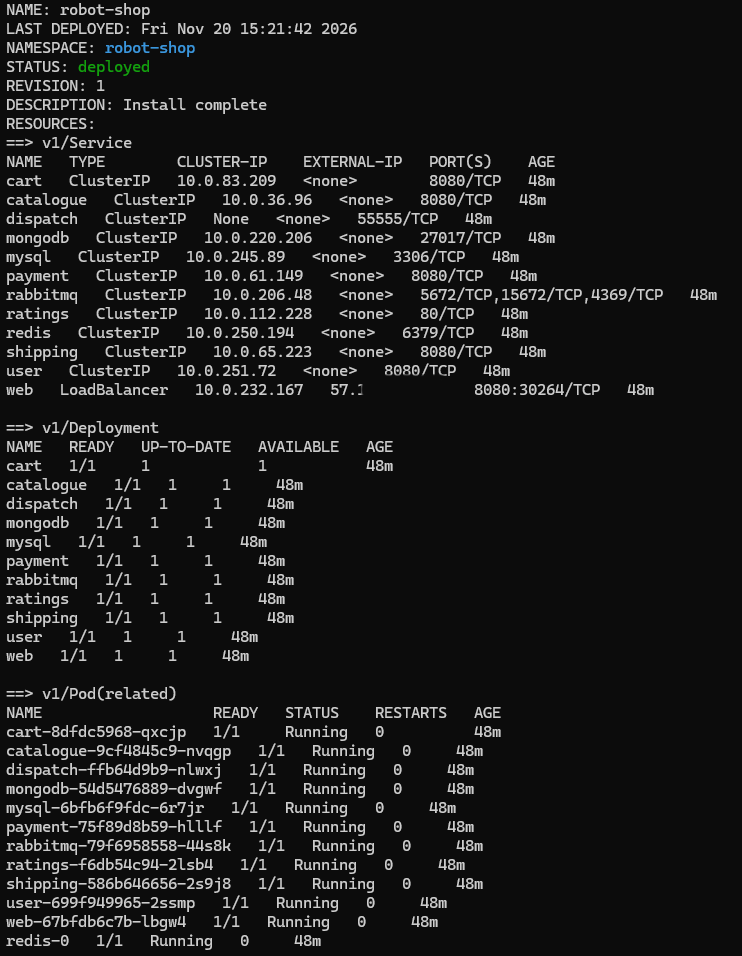
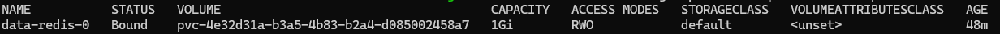

# Azure E-Commerce Platform on AKS

**Current implementation: v1.3.0 — repeatable Azure infrastructure lifecycle and orchestrated delivery for the Robot Shop sample.**

This project extends [Instana Robot Shop](https://github.com/instana/robot-shop), an upstream microservices demonstration, with Azure infrastructure and delivery automation. The sample application is the workload; this portfolio project focuses on how it is provisioned, built, deployed, secured, and cleaned up on Azure. It is for learning and demonstration, not production commerce.

The current v1.3.0 implementation adds Bicep-managed Azure resources, a bootstrapped Linux Azure DevOps agent, and a master pipeline that provisions infrastructure, publishes container images, and deploys the application to AKS.

## Contents

- [Application foundation](#application-foundation)
- [Project evolution](#project-evolution)
- [What v1.3.0 implements](#what-v130-implements)
- [Deployment architecture](#deployment-architecture)
- [Platform foundations and decisions](#platform-foundations-and-decisions)
- [Identity and access](#identity-and-access)
- [Prerequisites and manual setup](#prerequisites-and-manual-setup)
- [Deploy](#deploy)
- [Access the application](#access-the-application)
- [Clean up temporary infrastructure](#clean-up-temporary-infrastructure)
- [Verified evidence](#verified-evidence)
- [Security and limitations](#security-and-limitations)
- [Next iterations](#next-iterations)
- [Repository map](#repository-map)

## Application foundation

Robot Shop is an open-source sample e-commerce application composed of ten application images plus supporting Redis and RabbitMQ workloads. This repository builds on that application rather than presenting it as newly developed here. The engineering work progressed from getting the sample onto AKS to automating image delivery, adding secure Helm deployment, and orchestrating the infrastructure lifecycle.

## Project evolution

The sequence below shows how each release builds on the preceding platform milestone. GitHub currently lists formal releases through **v1.2.0**. This README describes the v1.3.0 implementation in release preparation; its formal GitHub tag and release have not yet been published.



| Version | Milestone |
|---|---|
| [v1.0.0](https://github.com/sharadshukla/E-Commerce/releases/tag/v1.0.0) | Established the Azure baseline: modular Bicep for ACR and AKS, an Azure DevOps infrastructure pipeline using WIF, AKS deployment with Helm, and public web access through a LoadBalancer. Image publishing, kubelet `AcrPull` assignment, and Helm installation were still manual. |
| [v1.1.0](https://github.com/sharadshukla/E-Commerce/releases/tag/v1.1.0) | Automated builds and publishing of all ten application images to ACR using Azure DevOps Build IDs, WIF, and registry-scoped `AcrPush`; Bicep parameters controlled conditional ACR/AKS provisioning. AKS deployment, kubelet `AcrPull`, and Helm installation remained manual. |
| [v1.2.0](https://github.com/sharadshukla/E-Commerce/releases/tag/v1.2.0) | Added secure Helm CD with WIF and namespace-scoped Kubernetes RBAC, explicit image-tag selection, and AKS image pulls through the kubelet managed identity. Infrastructure, image publishing, and Helm deployment remained separate pipeline runs. Validated with image tag `77`, Helm revision `2`, 12 Running pods, and 11 ready Deployments. |
| **v1.3.0 — current implementation** | Bootstraps a temporary Linux agent, orchestrates Infrastructure → Docker CI → Helm CD at the verified repository commit, discovers the application endpoint, and provides guarded cleanup. Formal release publication is pending approval. |

## What v1.3.0 implements

- Bicep provisions ACR and AKS in an existing application resource group. It also grants the AKS **kubelet managed identity** `AcrPull` on ACR.
- Bootstrap Bicep provisions an Ubuntu 24.04 VM and its network resources in a separate, existing resource group. Cloud-init checks out the exact repository commit; Ansible installs Docker, Azure CLI, PowerShell Core, `kubectl`, `kubelogin`, Helm, and the Azure DevOps agent.
- The VM's system-assigned managed identity retrieves the Azure DevOps agent-registration PAT from a pre-existing Key Vault secret. The PAT is not placed in the repository or cloud-init configuration.
- A local PowerShell script verifies the checked-out `main` commit and clean working tree, deploys the agent VM, waits for its agent to come online, queues the master pipeline at that exact Git revision, and monitors the run.
- The master pipeline runs Infrastructure, Docker CI, and Helm CD stages in sequence. Docker CI builds and pushes ten Robot Shop images with one shared `Build.BuildId` tag; Helm CD uses that tag and checks workload rollouts.
- A separate, preview-first cleanup script removes the temporary AKS, ACR, agent VM, and related resources while preserving the resource groups and persistent Azure DevOps/Key Vault configuration.

This is an automated deployment lifecycle with explicit manual prerequisites. It is not a zero-touch or one-click deployment: resource groups, Key Vault content, Azure DevOps connections and permissions, and local authentication must be prepared first.

## Deployment architecture



The master pipeline is defined in [`azure-pipelines-master.yml`](azure-pipelines-master.yml) and is queued by [`infra/bootstrap/infra-deploy.ps1`](infra/bootstrap/infra-deploy.ps1). Its YAML has CI and PR triggers disabled. The local script pins the run to the checked-out commit; the three stages execute on the temporary Linux self-hosted agent pool. For the documented user workflow, run it from an up-to-date `main` checkout. Standalone infrastructure, Docker CI, and Helm CD pipeline entry points remain available for isolated runs.

| Resource | v1.3.0 configuration |
|---|---|
| ACR | Basic SKU; admin account disabled. |
| AKS | Managed Microsoft Entra integration with native Kubernetes RBAC and local accounts disabled; one `Standard_D2as_v6` system pool autoscaling from one to three nodes. |
| Agent VM | Ubuntu 24.04, `Standard_D2s_v4`, system-assigned managed identity; deployed in East US with a public IP and an NSG that denies inbound Internet traffic. |

### End-to-end sequence

1. The local script validates Git state and deploys the Ubuntu agent VM from `infra/bootstrap/main.bicep`.
2. Cloud-init clones the public repository and checks out the exact verified commit. Ansible configures the agent and its build tools.
3. The script verifies the agent is online, queues `ecommerce-master-deployment` for the checked-out `main` commit, and waits for completion.
4. The master pipeline deploys ACR/AKS and bootstraps the `robot-shop` namespace and Kubernetes RBAC; builds/pushes the application images; then installs or upgrades the Helm release and verifies Deployments and StatefulSets.
5. After pipeline success, the local script attempts to discover the web Service endpoint. This final display is informational: if local AKS access or tools are unavailable, deployment can still have succeeded and the endpoint can be queried manually.

## Platform foundations and decisions

| Choice | Why it is used | Current scope |
|---|---|---|
| Bicep in existing resource groups | Keeps Azure resource configuration declarative and repeatable. | The operator creates the resource groups and persistent Key Vault configuration before deployment. |
| Workload identity federation | Lets Azure DevOps authenticate without storing an Azure client secret in pipeline YAML. | Service connections, their role assignments, and Kubernetes RBAC still require setup and review. |
| Separate registry identities | Keeps the ACR admin account disabled; the build identity publishes images and the AKS kubelet identity pulls them. | The master pipeline assigns `AcrPull` to the current kubelet identity during infrastructure provisioning. |
| Helm for application workloads | Packages the microservices, Services, image values, and release lifecycle in one chart. | The master pipeline installs/upgrades it with the Docker CI `Build.BuildId` and verifies rollout status. |
| Autoscaling AKS system pool | Provides a simple, cost-conscious learning cluster that can scale between one and three nodes. | This is node autoscaling; the project does not configure application HPA. |
| Public LoadBalancer for the web Service | Provides a direct browser path to demonstrate the sample application. | It exposes HTTP on port `8080`; ingress, TLS, and a custom domain are not configured. |

## Identity and access

The Mermaid diagram summarizes the identity flow implemented in v1.3.0. The companion diagram below expands it by phase: solid paths show implemented access, while the dashed pod-level Azure Workload Identity path is future scope and is not configured. The temporary agent VM uses a system-assigned managed identity; no user-assigned identity is configured for the VM.





| Identity or control | Purpose in this deployment |
|---|---|
| Human operator | Signs in locally to Azure and Azure DevOps CLI to deploy, queue, and clean up. This is separate from the pipeline WIF identities and the VM's Key Vault retrieval path. |
| Azure DevOps WIF service connections | `sc-az-ecommerce-wif` is used by infrastructure, Docker CI, and Helm CD tasks. `sc-az-ecommerce-aks-bootstrap-wif` obtains AKS credentials and applies the namespace and RBAC manifests. No client secret is stored in pipeline YAML. |
| Linux VM system-assigned managed identity | Receives `Key Vault Secrets User` at the agent-registration secret scope and reads the PAT during Ansible configuration. Sensitive Ansible tasks use `no_log`. Cleanup removes this temporary role assignment. |
| AKS control-plane and kubelet identities | The control-plane identity manages Azure resources. Bicep grants `AcrPull` to the kubelet identity, which performs node-level image pulls. This avoids assigning image-pull access to the wrong identity. |
| Kubernetes RBAC | The bootstrap connection creates the namespace-scoped Role and RoleBinding. Helm CD runs as the service principal named by the RoleBinding subject; that object ID must match the identity behind the pipeline connection. ReplicaSet access is read-only (`get`, `list`, `watch`). |

Azure RBAC governs Azure resource operations and access to AKS credentials; Kubernetes RBAC governs actions against the Kubernetes API. The exact role assignments for the Azure DevOps service connections are configured outside this repository and must be reviewed at the appropriate scope. Infrastructure deployment also needs permission to create the ACR role assignment.

## Prerequisites and manual setup

Complete these prerequisites before running the bootstrap script:

1. **Azure resource groups:** Create `e-commerce-app`, `ecommerce-bootstrap-rg`, and `ecommerce-security-rg` in the target subscription. The scripts deploy into these existing groups and cleanup preserves them.
2. **Key Vault:** Create the intended vault in `ecommerce-security-rg`, use the Azure RBAC permission model, and store the agent-registration PAT as `azdo-agent-registration-pat`. The PAT must be valid for agent registration and is read only by the VM identity at the secret scope. The current deploy script selects the first vault in that resource group, while cleanup expects `kv-ecommerce-agent-26641`; keep the intended vault as the only vault there or align both scripts before using multiple vaults.
3. **Azure DevOps:** Configure organization `sharadshukla19`, project `e-commerce-app`, the `ecommerce-linux-pool`, the `ecommerce-master-deployment` pipeline, and the two WIF service connections named above. Grant those identities the Azure and Kubernetes permissions their pipeline tasks require. Define `aksAdminGroupObjectId` for the master pipeline with the Microsoft Entra admin group object ID; it is an identifier, not a secret. Ensure the Helm RoleBinding subject matches the Helm pipeline service principal object ID.
4. **Local workstation:** Install Git, PowerShell, Azure CLI with Bicep, and the Azure DevOps CLI extension (`az extension add --name azure-devops`). Authenticate to the intended Azure subscription and Azure DevOps organization. If using PAT authentication for the local Azure DevOps CLI, sign in interactively with [`az devops login`](https://learn.microsoft.com/en-us/azure/devops/cli/log-in-via-pat?view=azure-devops) and enter the token at its prompt; do not put the PAT in a command, script, or repository. This operator sign-in path is separate from the VM retrieving the agent-registration PAT from Key Vault. The script also requires the SSH public key at `$HOME/.ssh/ecommerce-agent.pub`; password-based SSH is disabled.
5. **Endpoint lookup:** To have the local script display the application link, install `kubectl` and `kubelogin` locally and ensure your signed-in Entra user has AKS access. These tools and permissions are not required to open an already discovered public URL.

The bootstrap script currently assumes the resource names, region, VM size, agent pool, and organization values set in the script. If you change these values, keep the bootstrap, master pipeline, infrastructure, and cleanup configuration aligned.

## Deploy

After v1.3.0 is available on `main`, run from the repository root in PowerShell. Ensure your local `main` matches `origin/main` and the working tree is clean; the script stops if the checked-out commit differs from the remote `main` commit.

```powershell
git switch main
git fetch origin
git pull --ff-only origin main
git status --short
git rev-parse HEAD
git rev-parse origin/main

az login
az account set --subscription '<subscription-id>'
# Ensure the Azure DevOps CLI is authenticated for the configured organization.

.\infra\bootstrap\infra-deploy.ps1
```

From `main`, the script checks that `HEAD` equals `origin/main` and queues the master pipeline with that exact commit SHA. It verifies cloud-init completion, PowerShell Core, the agent service, and the Azure DevOps agent's Online status before queueing. It waits up to 90 minutes for the pipeline. The deployment can take several minutes while Azure resources and the application workloads start.

The `Build.BuildId` is the image tag shared by the Docker CI and Helm CD stages. The standalone Helm CD pipeline requires an explicit `imageTag`; the master pipeline supplies its shared build ID automatically.

## Access the application

After the master pipeline succeeds, the local bootstrap script attempts endpoint discovery using a temporary kubeconfig, which it removes afterward. It needs local `kubectl`, `kubelogin`, Azure CLI authentication, and AKS access. A discovery failure is reported as a warning and does not reverse a successful deployment.

To retrieve the endpoint manually:

```powershell
az aks get-credentials --resource-group e-commerce-app --name ecommerce-aks
kubelogin convert-kubeconfig -l azurecli
kubectl get service web --namespace robot-shop
```

Open `http://<EXTERNAL-IP>:8080` after the LoadBalancer address appears. The endpoint is public HTTP; this project does not configure ingress, a custom domain, or TLS.

## Clean up temporary infrastructure

Run cleanup locally, **not on `ecommerce-agent-vm`**. Start with the preview, inspect every target, then pass `-Execute` only when the listed resources are the intended temporary deployment:

```powershell
$subscriptionId = az account show --query id -o tsv
.\infra\bootstrap\infra-cleanup.ps1 -SubscriptionId $subscriptionId
```

For deletion, run the same command with `-Execute` and type the requested confirmation phrase when prompted:

```powershell
.\infra\bootstrap\infra-cleanup.ps1 -SubscriptionId $subscriptionId -Execute
```

Cleanup verifies the selected subscription and expected resource inventory. It blocks deletion if it finds unexpected resources or an agent with an active job. After explicit confirmation (`DELETE ECOMMERCE INFRA`) it deregisters the target agent, removes the temporary Key Vault role assignment, deletes AKS and ACR, deletes the agent VM and its OS disk, and removes the VM network resources. It verifies the AKS-managed resource group is gone.

**Preserved:** all three resource groups; the Key Vault and PAT secret; Azure DevOps agent pool, pipelines, and service connections; and persistent role assignments. Cleanup is targeted at the known deployment resources, not a general resource-group purge.

## Verified evidence

The v1.3.0 workflow was exercised successfully: the Linux agent came Online; the Infrastructure, Docker CI, and Helm CD stages completed; Robot Shop was deployed and opened in a browser; and controlled cleanup verified removal of temporary resources while preserving the persistent configuration listed above.

The 20 November 2026 deployment captures show Helm release `robot-shop` as `deployed` at revision `1`, all **10 Deployments** ready, the Redis StatefulSet ready, and all **12 pods** Running with zero restarts. The Redis PVC was Bound, the Linux agent was Online, and the web application loaded successfully.









*The public LoadBalancer IP is partially redacted in this capture.*



## Security and limitations

- Robot Shop is an upstream sample and is not production-ready. MySQL data is not persistent in this chart; Redis uses a PVC and expects a StorageClass named `default`.
- The web Service is a public LoadBalancer over HTTP on port 8080. No TLS, ingress, or custom domain is configured.
- The agent VM receives a public IP, but its NSG denies inbound Internet traffic. Bootstrap status checks use Azure VM Run Command; the configured SSH key does not imply direct Internet SSH access. The VM requires outbound connectivity to retrieve packages and reach GitHub, Azure, and Azure DevOps.
- The Key Vault integration stores the Azure DevOps agent-registration PAT only. Application secrets are not moved into Key Vault, and AKS Workload Identity for application pods is not configured.
- The Helm Role is namespace-scoped but has create/update/patch/delete access to several workload resources and secrets so Helm can manage its release. Restrict who can use the corresponding Azure DevOps connection.
- Some bootstrap dependencies are not version-pinned: the Ubuntu image uses `latest`, and Ansible installs current package/tool versions for several components. Rebuilds can therefore differ over time even when the source commit is fixed.
- The bootstrap Key Vault lookup and cleanup vault name differ as described above. This assumes a single intended vault in the security resource group.
- The ReplicaSet read-only RBAC refinement (`get`, `list`, `watch`) is documented but still requires live-cluster verification after AKS recreation.

## Next iterations

1. Remove the remaining local Windows orchestration dependency by moving bootstrap and deployment control to a hosted controller or Azure Linux host.
2. Add Azure Monitor / Log Analytics observability and operational dashboards.
3. Extend Key Vault use to application-secret management where the sample application supports it.
4. Explore AI-assisted Kubernetes troubleshooting with observable signals and controlled remediation.

## Repository map

- `infra/main.bicep`, `infra/modules/` — application infrastructure and ACR pull role assignment.
- `infra/bootstrap/` — agent VM Bicep, cloud-init, deploy orchestration, and controlled cleanup.
- `ansible/playbook.yml` — Linux agent and toolchain provisioning.
- `azure-pipelines-master.yml` — Infrastructure → Docker CI → Helm CD orchestration.
- `azure-pipelines.yml`, `pipelines/` — standalone pipelines and reusable stage templates.
- `AKS/rbac/` — namespace Role and RoleBinding for Helm deployment.
- `AKS/helm/` — Robot Shop Helm chart and chart-specific guidance.
- `docs/images/` — v1.3.0 deployment evidence and historical captures.

The upstream application is licensed under the terms in [LICENSE](LICENSE). Optional upstream Fluentd and load-generation examples are not part of the verified Azure deployment workflow.
