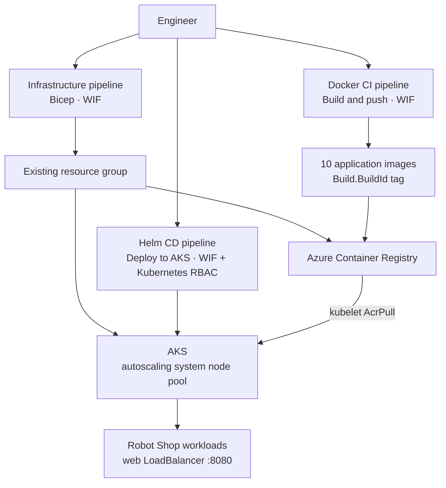

# Azure E-Commerce Platform on AKS

**v1.2.0 — Azure infrastructure and secure CI/CD for the Robot Shop microservices sample.**

This repository extends the upstream [Instana Robot Shop](https://github.com/instana/robot-shop) demonstration application with Azure infrastructure and deployment workflows. The application is for demonstration and learning; it is not a production commerce platform.

## Table of contents

- [What this project delivers](#what-this-project-delivers)
- [Architecture](#architecture)
- [Security model](#security-model)
- [Pipelines and deployment workflow](#pipelines-and-deployment-workflow)
- [Prerequisites and manual setup](#prerequisites-and-manual-setup)
- [Reproduce the v1.2.0 deployment](#reproduce-the-v120-deployment)
- [Verified deployment evidence](#verified-deployment-evidence)
- [Operational learning](#operational-learning)
- [Scope and limitations](#scope-and-limitations)
- [Next iterations](#next-iterations)
- [Repository areas](#repository-areas)
- [Upstream project and license](#upstream-project-and-license)

## What this project delivers

- Azure Container Registry (ACR) and Azure Kubernetes Service (AKS) provisioned with Bicep into an existing resource group.
- Three separately queued Azure DevOps pipelines for infrastructure provisioning, Docker CI to ACR, and Helm CD to AKS.
- Workload identity federation (WIF) for Azure DevOps authentication, registry-scoped image publishing, and namespace-scoped Kubernetes RBAC for Helm deployment.
- A Helm chart for deploying the Robot Shop services, with the web frontend exposed through a Kubernetes LoadBalancer Service.

## Architecture



The pipelines are separate and manually queued. Infrastructure provisioning, image publishing, and Helm deployment are not orchestrated as a single end-to-end run. Namespace/RBAC preparation and AKS-to-ACR image-pull authorization also require configuration outside these pipelines.

## Security model

- Azure DevOps authenticates through the `sc-az-ecommerce-wif` workload identity federation service connection; pipeline YAML contains no Azure client secret.
- The ACR admin account is disabled. The Docker CI identity uses `AcrPush` on the registry.
- AKS pulls images through its **kubelet managed identity**, which needs `AcrPull` on ACR. The earlier deployment issue assigning this role to the AKS control-plane identity was corrected by granting it to the kubelet identity.
- AKS uses Microsoft Entra integration and disables local accounts. The Helm pipeline identity needs the required AKS access and a RoleBinding in the `robot-shop` namespace.
- The current ReplicaSet RBAC rule grants only `get`, `list`, and `watch`. This latest refinement is **pending live-cluster verification** because the AKS infrastructure has been deleted. Earlier WIF and Kubernetes RBAC checks were exercised during deployment; they do not verify this latest manifest revision.

## Pipelines and deployment workflow

### 1. Infrastructure provisioning — [`azure-pipelines.yml`](azure-pipelines.yml)

The pipeline validates and deploys `infra/main.bicep` to an existing resource group, creating ACR and AKS. Set the Azure DevOps pipeline variable `aksAdminGroupObjectId` to the Microsoft Entra admin group’s object ID before running it. The script validates that the value is present and is a GUID, then supplies it as the required Bicep parameter. This object ID is configuration, not a secret.

### 2. Docker CI to ACR — [`pipelines/docker-acr.yml`](pipelines/docker-acr.yml)

The manually queued pipeline builds and pushes ten application images to ACR, tagging them with `Build.BuildId`. It publishes images only; it does not deploy the application. The v1.2.0 deployment used image tag **`77`**.

### 3. Helm CD to AKS — [`pipelines/helm-aks-cd.yml`](pipelines/helm-aks-cd.yml)

Queue the pipeline with the `imageTag` parameter set to a tag already published to ACR. The parameter has no default; the pipeline stops with a clear error if it is missing. It validates WIF authentication and Kubernetes permissions, then runs `helm upgrade --install` and checks the release status. Use `77` to reproduce the v1.2.0 image deployment, provided those images remain in ACR.

## Prerequisites and manual setup

- An Azure subscription and an existing resource group.
- Azure DevOps access, the `sc-az-ecommerce-wif` service connection, and Azure permissions sufficient for Bicep deployment. Configure the `aksAdminGroupObjectId` pipeline variable for the infrastructure run.
- For Docker CI, an agent with Docker support for Linux containers and the WIF identity granted `AcrPush` on ACR. The verified run used a local Windows self-hosted agent.
- For Helm CD, AKS access for the WIF identity, plus `kubectl`, `kubelogin`, and Helm on the agent.
- Before Helm CD, create the `robot-shop` namespace and apply the namespace Role and RoleBinding in [`AKS/rbac/`](AKS/rbac/). Set the RoleBinding subject to the object ID of the WIF service principal used by the pipeline.
- Grant the current AKS kubelet managed identity `AcrPull` on ACR. This is a manual prerequisite in v1.2.0.
- The chart’s Redis StatefulSet expects a StorageClass named `default`; verify that it exists in AKS.

## Reproduce the v1.2.0 deployment

1. Queue the infrastructure pipeline after configuring `aksAdminGroupObjectId`.
2. Ensure the `robot-shop` namespace and RBAC resources are configured, and grant the AKS kubelet identity `AcrPull` on ACR.
3. Queue the Docker CI pipeline and record its `Build.BuildId` tag. The verified v1.2.0 run used `77`.
4. Queue Helm CD with `imageTag` set to that published tag. The v1.2.0 run used `77`.
5. Check the Helm release and workloads:

```bash
helm status robot-shop --namespace robot-shop
kubectl get pods --namespace robot-shop
kubectl get deployments --namespace robot-shop
kubectl get services --namespace robot-shop
```

After AKS is recreated, its kubelet identity may have a different object ID. Verify that the **current** kubelet identity has `AcrPull` on the registry, and reestablish the role assignment if needed.

For a manual Helm fallback, see [`AKS/helm/README.md`](AKS/helm/README.md).

## Verified deployment evidence

The v1.2.0 deployment used Docker CI tag **`77`**. Helm CD completed successfully with release revision **2** and status **`deployed`**. At verification, all **12 pods were Running**, all **11 Deployments were ready**, and the web application was opened successfully in a browser. WIF authentication and Kubernetes RBAC checks were exercised during that deployment. The current ReplicaSet read-only rule was added afterward and remains unverified against a live cluster.

The screenshot below is historical evidence from an earlier deployment on 11 October 2026; it does not depict the v1.2.0 tag `77` run.


*Historical pod status captured during the 11 October 2026 deployment verification.*

During an earlier deployment, `AcrPull` was assigned to the AKS control-plane identity rather than the kubelet managed identity, so image pulls failed. Reassigning the role to the kubelet identity resolved the issue.

## Operational learning

An earlier Helm install timed out while MySQL and dependent services were still initializing. The workloads later recovered after a controlled MySQL restart, but the exact cause of the initialization delay was not established. v1.2.0’s successful Helm revision 2 confirms the later deployment completed and its release status was `deployed`.

## Scope and limitations

- Robot Shop is an upstream demonstration application, not a production-ready commerce system.
- The pipelines are manually queued and separate. Manual identity/RBAC setup remains, and there is no automatic handoff from Docker CI to Helm CD.
- The resource group must exist before infrastructure provisioning.
- The chart’s MySQL workload has no persistent volume; MySQL data is not durable across pod replacement. Redis uses a persistent volume and requires the expected StorageClass.
- The web Service uses a public LoadBalancer on port 8080. Ingress, a custom domain, and TLS are not configured.
- The latest ReplicaSet RBAC refinement has not been checked against a live AKS cluster.

## Next iterations

1. **v1.3.0 priority:** Move Azure DevOps execution from the local Windows self-hosted agent to Microsoft-hosted agents or an Azure Linux VM, accounting for Docker build requirements.
2. Orchestrate infrastructure, Docker CI, and Helm CD end to end, including the required identity and ACR pull permissions, after defining safe prerequisites and approvals.
3. Add observability with Azure Monitor/Log Analytics and manage application secrets with Key Vault.
4. Explore AI-assisted Kubernetes troubleshooting using deployment and observability data, with controlled remediation.

## Repository areas

- `infra/` — Bicep entry point and AKS module.
- `AKS/helm/` — Helm chart, templates, and manual deployment instructions.
- `AKS/rbac/` — namespace Role and RoleBinding used by Helm CD.
- `azure-pipelines.yml` — Azure DevOps infrastructure pipeline.
- `pipelines/docker-acr.yml` — Docker build and ACR push pipeline.
- `pipelines/helm-aks-cd.yml` — Helm deployment pipeline for AKS.
- Application service directories — upstream Robot Shop source and Dockerfiles.
- `docs/images/` — selected deployment evidence.

## Upstream project and license

The application is based on [Instana Robot Shop](https://github.com/instana/robot-shop). This repository adds the Azure infrastructure and delivery workflows described above. See [LICENSE](LICENSE) for the repository license.

---

**Release scope:** v1.2.0 adds a WIF-authenticated Helm CD pipeline and namespace-scoped Kubernetes RBAC to the Azure infrastructure and Docker-to-ACR CI. The three pipeline responsibilities remain separately triggered, with identity/RBAC prerequisites configured manually.
