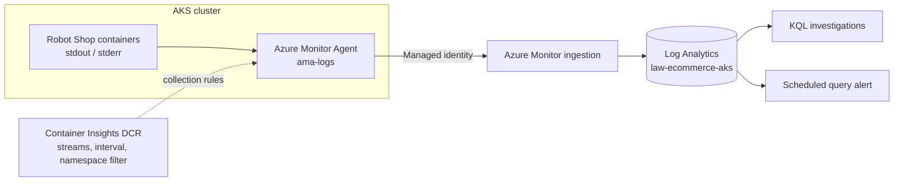
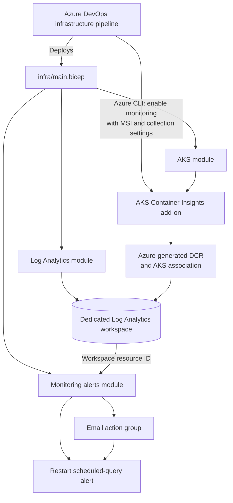
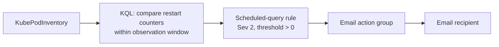

# E-Commerce v1.4.0 — Observability implementation notes

> **Milestone 1:** AKS Container Insights, Log Analytics, KQL, restart alerting, and resource lifecycle. This document distinguishes **verified Azure behavior** from **new IaC changes awaiting a clean deployment and cleanup test**. Managed Prometheus and Grafana are reserved for Milestone 2.

## Contents

- [Scope](#scope)
- [Runtime observability architecture](#runtime-observability-architecture)
- [Provisioning and dependencies](#provisioning-and-dependencies)
- [Alerting flow and behavior](#alerting-flow-and-behavior)
- [Engineering decisions](#engineering-decisions)
- [Operational KQL queries](#operational-kql-queries)
- [Verification evidence](#verification-evidence)
- [Fresh-deployment acceptance checks](#fresh-deployment-acceptance-checks)
- [Milestone boundaries](#milestone-boundaries)

## Scope

Milestone 1 establishes centralized AKS application logs, pod inventory, managed-identity authentication, operational KQL queries, a basic container-restart alert, and safe provisioning/cleanup of project-owned monitoring resources. The Robot Shop application runs in the `robot-shop` namespace.

## Runtime observability architecture



The Azure Monitor Agent collects configured container telemetry. The Container Insights data collection rule (DCR) defines streams and collection settings; its association links the rule to AKS. A configured DCR alone does **not** prove that logs are arriving in the workspace.

## Provisioning and dependencies



**Provisioning ownership:** Bicep provisions the dedicated Log Analytics workspace and the operational alert/action group, alongside AKS and ACR. After the Bicep deployment, `pipelines/templates/infrastructure-steps.yml` enables Container Insights with `az aks enable-addons`, managed-identity authentication, and `infra/monitoring/data-collection-settings.json`. Azure creates the Container Insights DCR and association. **Do not also deploy** the old custom `infra/modules/container-insights-dcr.bicep` during this flow.

The alert module receives the Log Analytics workspace ID and a deployment-provided `alertEmail`; the pipeline maps the Azure DevOps `monitoringAlertEmail` variable into that parameter. The intent is to create both alert resources in `e-commerce-app`, not `NetworkWatcherRG`. These latest Bicep changes are **not yet verified in a fresh Azure deployment**.

## Alerting flow and behavior



The rule looks for an **increase** in `ContainerRestartCount` for the same pod/container, not merely a nonzero cumulative count. The manually tested rule used a 15-minute evaluation frequency, 15-minute aggregation window, table-row count greater than zero, and Severity 2. This sampling-based approach can miss an increase outside the query window or when insufficient inventory samples are collected. The Bicep-created rule's exact deployed configuration must be inspected in the next run.

## Engineering decisions

| Concern | Decision |
|---|---|
| Container Insights ownership | One Azure CLI add-on onboarding path; no competing custom DCR deployment |
| Collection | `Microsoft-ContainerLogV2`, `Microsoft-KubeEvents`, `Microsoft-KubePodInventory`; 5-minute interval; exclude `kube-system` |
| Identity | Require AKS add-on `useAADAuth=true`; validate runtime ingestion, not merely identity assignment |
| CI/CD authentication | Azure DevOps workload identity federation and a separate AKS bootstrap service connection; temporary kubeconfig |
| Alert email | Supply through an Azure DevOps variable / secure Bicep parameter; do not commit recipient details |
| Lifecycle | Remove project-owned AKS, ACR, LAW, DCR, alert, action group and agent VM; preserve shared Key Vault, DevOps configuration, resource groups, and default Azure Monitor workspace |
| Cleanup safety | Preview by default, explicit confirmation, allowlist of expected resources, post-deletion verification; report remaining resources rather than claiming success |

The application workspace is `law-ecommerce-aks`. The default/shared workspace (for example, `defaultazuremonitorworkspace-eus`) is **not** an automatic cleanup target; ownership and dependencies must be assessed separately. Alert rules and action groups are Azure resources in their own right and need explicit lifecycle handling.

## Operational KQL queries

### Application logs and ingestion freshness

```kusto
ContainerLogV2
| where TimeGenerated > ago(1h) and PodNamespace == 'robot-shop'
| summarize Records=count(), LatestEvent=max(TimeGenerated), LatestIngestion=max(ingestion_time()) by ContainerName
| order by Records desc
```

### Error investigation (keyword-based, not authoritative severity)

```kusto
ContainerLogV2
| where TimeGenerated > ago(1h) and PodNamespace == 'robot-shop'
| extend Message=tostring(LogMessage)
| extend Category=case(
    Message contains 'User Deprecated', 'Deprecation',
    Message contains 'instana:' and Message contains 'ERROR', 'Instrumentation',
    Message matches regex @'(?i)\b(error|exception|failed)\b', 'Potential Error',
    'Other')
| where Category != 'Other'
| summarize Records=count() by ContainerName, Category
| order by Records desc
```

### Latest pod state and cumulative restart count

```kusto
KubePodInventory
| where TimeGenerated > ago(30m) and Namespace == 'robot-shop'
| summarize arg_max(TimeGenerated, *) by PodUid, ContainerName
| project TimeGenerated, PodName=Name, ContainerName, PodStatus, ContainerRestartCount
| order by PodName asc
```

### Restart increase used by the alert

```kusto
KubePodInventory
| where TimeGenerated > ago(15m)
| where Namespace == 'robot-shop' and isnotempty(ContainerName)
| summarize MinRestarts=min(ContainerRestartCount), MaxRestarts=max(ContainerRestartCount), Samples=count()
    by PodUid, Name, ContainerName
| extend RestartIncrease = MaxRestarts - MinRestarts
| where Samples >= 2 and RestartIncrease > 0
| project PodName=Name, ContainerName, RestartIncrease, Samples
| order by RestartIncrease desc
```

## Verification evidence

| Date | Verified observation | Limits |
|---|---|---|
| 22 Nov 2026 | After correcting Container Insights managed-identity onboarding, `useAADAuth` and agent `USING_AAD_MSI_AUTH` reported true; fresh `robot-shop` logs appeared in `ContainerLogV2` | Earlier implementation included manual reconciliation |
| 22 Nov 2026 | KQL exposed logs from seven application components and 12/12 pods in Running phase in the sampled window | Pod phase and cumulative restart counts are not readiness/SLO checks |
| 26 Nov 2026 | Automated infrastructure deployment produced `useAADAuth=true`, one DCR in the application RG, expected data collection settings, and an AKS DCR association | The then-current automated deployment did not include the new Bicep-created alert |
| 26 Nov 2026 | `ContainerLogV2` returned 3,181 `robot-shop` records in a one-hour query window with recent ingestion | Count and ingestion timestamps describe that sample window only |
| 26 Nov 2026 | Temporary test pod entered `CrashLoopBackOff`; `KubePodInventory` showed a restart increase; scheduled-query alert fired and a **Sev 2** email arrived | Alert and action group were created through the portal, not Bicep |
| 26 Nov 2026 | Project infrastructure was removed after cleanup-script execution and a separate action-group deletion; follow-up resource lists were empty | The latest revised cleanup/reporting script has **not** yet completed an unattended-from-script cleanup test |

The original debugging also showed legacy `ContainerLog` ingestion while `USING_AAD_MSI_AUTH=false`, despite V2 DCR settings. This is why both identity settings **and actual `ContainerLogV2` ingestion** are required acceptance checks. Observed application log noise included PHP deprecations, Instana connectivity errors, and a web 404; these were not evidence of Azure Monitor failure.

## Fresh-deployment acceptance checks

- [x] PowerShell cleanup script parses, Bicep template builds, and `git diff --check` passes locally (reported 27 Nov 2026).
- [ ] Fresh `infra-deploy.ps1` run provisions Linux agent and completes the master pipeline from the intended Git commit.
- [ ] Bicep creates `alert-ecommerce-container-restarts` and `ag-ecommerce-monitoring` in **`e-commerce-app`**; check rule enabled, Sev 2, 15-minute evaluation, LAW scope, query, action-group linkage, and configured email receiver.
- [ ] Container Insights uses managed identity; exactly one expected AKS association and the intended DCR streams/filter settings exist.
- [ ] After Helm deployment, fresh application logs are visible in `ContainerLogV2` and pod inventory is populated.
- [ ] Verify the Bicep-provisioned alert, including action-group delivery; repeat the controlled restart test if needed.
- [ ] Run cleanup preview, then cleanup with explicit confirmation. Confirm all project-owned resources, agent registration, role assignment and AKS-managed RG are gone **without manual deletion**, while shared resources remain.
- [ ] Review residual resources and Azure Cost Management before marking Milestone 1 complete; update README with observed outcomes.

## Milestone boundaries

Milestone 1 is complete only after the **latest** provisioning and cleanup automation pass the checks above and the documentation reflects the results. **Milestone 2:** evaluate Managed Prometheus and Grafana separately, including their own provisioning, cost and cleanup. Future ephemeral/on-demand CI/CD agents remain out of scope.
