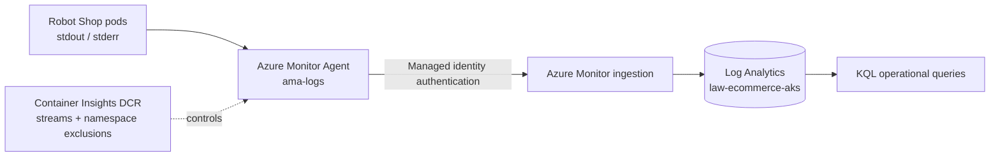

# E-Commerce v1.4.0 — Container Insights implementation notes

> Scope: Milestone 1 logging, identity, KQL verification, and resource lifecycle. This is a documentation draft for integration into the repository README, not a declaration that the revised automation has been deployed.

## Architecture



## Decisions

- **Single owner for Container Insights:** the infrastructure pipeline enables the AKS monitoring add-on once using the existing dedicated Log Analytics workspace and `infra/data-collection-settings.json`. Azure generates its DCR and association. Do **not** also deploy `modules/container-insights-dcr.bicep`.
- **Identity:** require `addonProfiles.omsagent.config.useAADAuth == 'true'` and validate actual AMA behavior. The AKS system-assigned identity and the add-on-managed identity are not interchangeable evidence of agent authentication.
- **Collection:** use `ContainerLogV2`, `KubeEvents`, and `KubePodInventory`, with five-minute interval and `kube-system` excluded. Scope excludes system logs to manage ingestion cost. A request to collect additional namespaces must be explicit.
- **Security:** Azure DevOps uses a federated service connection, not an embedded client secret. The AKS bootstrap uses a distinct connection and a temporary kubeconfig. Avoid logging credentials, full environment variables, and sensitive application log payloads.
- **Lifecycle:** dedicated LAW and project-specific DCRs are disposable; the default/shared Azure Monitor workspace and Key Vault remain outside automatic deletion. The cleanup script defaults to preview, requires confirmation, and blocks unexpected resources.

## Verified operational findings from 22 Nov 2026

1. A monitoring add-on originally reported `USING_AAD_MSI_AUTH=false`, and fresh logs appeared in legacy `ContainerLog` rather than `ContainerLogV2`, despite V2 configuration in the DCR.
2. After re-enabling the add-on with managed identity authentication, `useAADAuth` and `USING_AAD_MSI_AUTH` reported true. Fresh records from `robot-shop` appeared in `ContainerLogV2` (598 records in one query window; later service-level counts were also observed).
3. KQL verified logs from `ratings`, `dispatch`, `mongodb`, `cart`, `user`, `catalogue`, and `web`. Text categorization found Symfony deprecations and Instana connection noise; a web error represented a request for a nonexistent `/login` path, not an Azure Monitor ingestion failure.
4. `KubePodInventory` reported 12 of 12 Robot Shop pods in Running phase, with zero *reported cumulative restarts* for the sampled containers. This does not independently establish readiness or application-level SLOs.
5. A cleanup attempt failed while deleting multiple monitoring resources in one CLI operation; manual resource inventory after cleanup reported no project application resources. The updated cleanup script requires fresh end-to-end verification.

## Operational queries (validated against the earlier running environment)

### Service logs and ingestion freshness

```kusto
ContainerLogV2
| where TimeGenerated > ago(1h) and PodNamespace == 'robot-shop'
| summarize Records=count(), LatestEvent=max(TimeGenerated), LatestIngestion=max(ingestion_time()) by ContainerName
| order by Records desc
```

### Error investigation (keyword-based, not authoritative severity)

```kusto
ContainerLogV2
| where TimeGenerated > ago(1h) and PodNamespace == 'robot-shop'
| extend Message=tostring(LogMessage)
| extend Category=case(
    Message contains 'User Deprecated', 'Deprecation',
    Message contains 'instana:' and Message contains 'ERROR', 'Instrumentation',
    Message matches regex @'(?i)\b(error|exception|failed)\b', 'Potential Error',
    'Other')
| where Category != 'Other'
| summarize Records=count() by ContainerName, Category
| order by Records desc
```

### Latest pod phase and restart count

```kusto
KubePodInventory
| where TimeGenerated > ago(30m) and Namespace == 'robot-shop'
| summarize arg_max(TimeGenerated, *) by PodUid, ContainerName
| project TimeGenerated, PodName=Name, ContainerName, PodStatus, ContainerRestartCount
| order by PodName asc
```

## Fresh deployment acceptance checks (NOT YET run for this patch)

1. Run Bicep static build and Azure DevOps pipeline YAML validation.
2. Run full infrastructure provisioning. Confirm add-on enabled, `useAADAuth == 'true'`, one `ContainerInsightsExtension` association, matching streams, expected namespace filters, and agent pods running.
3. After Helm, confirm actual `robot-shop` logs in `ContainerLogV2` and fresh pod inventory; a configured DCR is not proof of ingestion.
4. Test alert configuration (still pending Milestone 1), then run cleanup in preview followed by explicit execution, and confirm no project-owned resources remain.
5. Inspect subscription-wide resources and Azure Cost Management for delayed billable ingestion; do not automatically delete default/shared workspaces.

## Boundaries

- Operational alerting is **not implemented** by this patch.
- Managed Prometheus/Grafana is **Milestone 2** and must be independently verified.
- Future on-demand/ephemeral CI/CD agents are intentionally out of scope.
